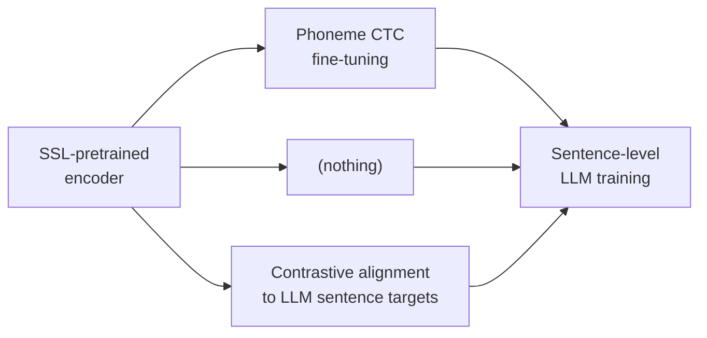
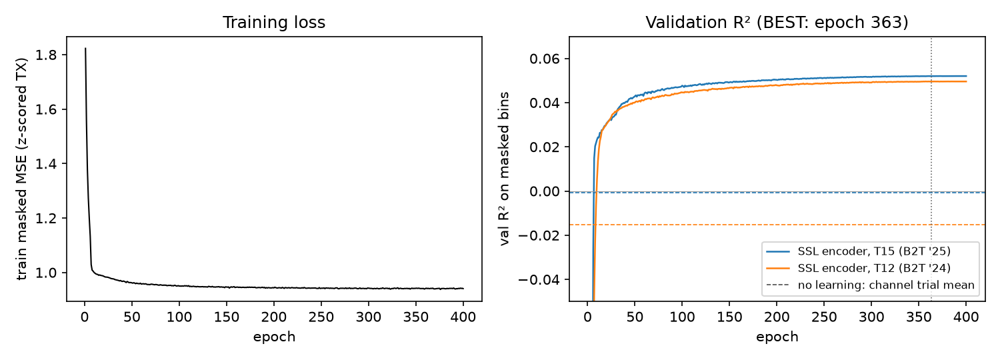

# BIT-Experiments

Experiments on **BIT** (BraIn-to-Text), a brain-to-text decoder that reads attempted speech from
intracortical neural recordings. BIT uses a transformer encoder to turn neural activity into a
sequence of tokens, then feeds those tokens to a language model (Aero-1-Audio, an audio-tuned
Qwen2.5-1.5B, fine-tuned with LoRA) that produces the decoded sentence.

> Zhang et al., "A cross-species neural foundation model for end-to-end speech decoding", ICLR 2026 — [arXiv 2511.21740](https://arxiv.org/abs/2511.21740), code: [yzhang511/bit](https://github.com/yzhang511/bit)

**Main question.** BIT trains its encoder on phoneme labels before connecting it to the language
model, and reports that skipping that stage fails. Can the phoneme stage be replaced by
self-supervised pretraining and contrastive alignment to the language model's own representations?

## Three arms

Every arm starts from the same self-supervised encoder and ends with the same sentence-level
language-model training. They differ only in what happens between those two stages:



| Arm | Middle stage | Status |
|---|---|---|
| **A** — phoneme-first (BIT's recipe) | Phoneme CTC fine-tuning | Phoneme stage done; sentence training running |
| **B** — direct | None | Done (one seed; two more seeds queued) |
| **C** — contrastive-first (new) | Contrastive alignment to fixed LLM sentence targets; no LLM, no phonemes | Stage 1 done; sentence training queued |

Arm B has been trained with several language models and two training objectives (autoregressive and
block diffusion). Arms A and C are running next, followed by additional seeds for arm B.
Full design: [`docs/DESIGN.md`](docs/DESIGN.md).

## Results

Data: Brain-to-Text '25 (participant T15). BIT splits the official validation set into BIT-val
(713 trials) and BIT-test (713 trials); the competition holdout is never used. 11.4% of test
trials repeat a training sentence, so seen and unseen results are reported separately. All results
below are one seed unless noted otherwise.

Details, caveats and full audit: [`results/SUMMARY.md`](results/SUMMARY.md).
All metrics: [`results/metrics.csv`](results/metrics.csv).

### BIT reproduction

Phoneme error rate 8.91% on BIT-val (paper: 8.87%).

Two properties of BIT's released code affect what its sentence-level numbers mean. First, the
sentence stage never loads the phoneme encoder — the checkpoint key is written to the wrong config
path — so the released end-to-end model is a randomly initialized encoder trained directly on
sentences. Second, the default evaluation is teacher-forced: each word is predicted from the true
preceding words, not generated freely. Every arm in this repo loads its starting checkpoint
explicitly and is scored by free generation. See [`results/SUMMARY.md`](results/SUMMARY.md) for the
full audit.

### SSL pretraining

BIT's masked-modeling objective, trained on 60 hours of speech recordings (three participants).
After correcting for a smoothing leak in BIT's input path, the encoder predicts masked-out neural
activity in held-out recordings at R² = 0.042 (T15) and 0.033 (T12). No-learning baselines
score ≤ 0.



### Contrastive alignment (arm C, Stage 1)

Without any language model or phoneme labels, the encoder retrieves the correct sentence among
704 candidates 35.8% of the time on BIT-test (top-5: 65.2%; chance: 0.14%). It works equally
well on sentences never seen during training (36.1%).

### Sentence decoding (arm B, Stage 2)

Free-generation greedy word error rate on BIT-test, selected on BIT-val. Every run starts from
the same SSL-pretrained encoder with no phoneme stage.

| Decoder (LLM, training objective) | Test WER | Seen / unseen |
|---|---|---|
| Aero-1-Audio, block diffusion | **21.76%** | 10.4 / 23.2 |
| Qwen2.5-1.5B-Instruct, block diffusion | 23.65% | 15.4 / 24.7 |
| Fast-dLLM v2 1.5B, block diffusion | 25.22% | 15.2 / 26.5 |
| BIT's released checkpoint (free generation) | 33.6% | 11.5 / 36.4 |
| Aero-1-Audio, autoregressive (BIT's sentence stage, no phoneme stage) | 34.23% | 19.7 / 36.1 |
| Qwen2.5-1.5B base, no prompt, autoregressive | 43.75% | 21.3 / 46.6 |
| Qwen2.5-1.5B-Instruct, autoregressive | 55.66% | 26.7 / 59.3 |

Null controls (shuffled input, noise, prompt only) give 99–142% WER across runs, confirming the
output depends on the neural input.

**Block-diffusion training is the largest single gain.** Switching Aero from autoregressive to block-
diffusion training drops WER by 12.47 percentage points [−14.52, −10.54] on the same LLM. Aero's
audio post-training helps ~21 pp under autoregressive training (34.2 vs 55.7) but only ~1.9 pp
under diffusion. Strict left-to-right decoding of the diffusion model costs only +1.2 pp, so
the gain comes from training, not from the decoding order
([`results/stage2/B_ssl_fast-dllm-v2-1.5b_s42/decoding_order/`](results/stage2/B_ssl_fast-dllm-v2-1.5b_s42/decoding_order/)).

**How the errors differ.** Our reading is that diffusion decoders lean more on the neural signal and less on the
language model's prior. Because the signal is from speech-motor cortex, diffusion's wrong words
tend to sound like the right ones (25.9% of substitutions for Aero diffusion vs 16.1% for Aero
autoregressive; chance is ~2.7%). However, matched on the same trial and the same number of word
errors, autoregressive errors keep slightly more meaning (−0.041 [−0.065, −0.018]): autoregressive
decoding is all-or-nothing, while diffusion fails more gracefully but with sound-based slips.
Details: [`results/stage2/phonetic_errors.md`](results/stage2/phonetic_errors.md).

**Eval-time input ablations.** Removing ventral area 6v or area 55b costs ~20–25 pp; removing
dorsal 6v costs only 1–2 pp. At matched damage, dropping v6v reduces the sound-alike excess more
than dropping 55b, so v6v carries more of the phonetic detail. Removing input never makes the
wrong words more language-driven
([`results/stage2/ablations_summary.md`](results/stage2/ablations_summary.md),
[`results/stage2/ablation_error_types.md`](results/stage2/ablation_error_types.md)).

**Comparison with the BIT paper.** BIT's end-to-end result (11.06% WER, arXiv 2511.21740v5) uses
the competition holdout, nucleus sampling, and the BIT-All encoder (366.8 hours of human + monkey
pretraining). Ours uses BIT-test, greedy decoding, and 60 hours of human pretraining. The
remaining ~10 pp gap mixes the split, the decoding method, and the pretraining scale. Arm A
(phoneme-first) on our setup will measure how much of the gap comes from the phoneme stage.

### Still running

- Arm A with autoregressive and block-diffusion decoders (completing the phoneme yes/no × objective
  2×2 table).
- Arm C with both decoders.
- Additional seeds (43, 44) for arm B.
- A 50% training-data run.
- A phoneme-eraser retraining ablation.

## Related: Kunz et al. 2025 isolated-word decoding

A separate project reproducing and extending the isolated-word analysis from Kunz et al. 2025
(*Cell*, [PMC12360486](https://pmc.ncbi.nlm.nih.gov/articles/PMC12360486/)):
[molinzhao27/KunzInnerSpeechReproduction](https://github.com/molinzhao27/KunzInnerSpeechReproduction).

## Layout

```
src/bit_experiments/       main package: SSL, contrastive alignment, sentence training, evaluation
scripts/                   one entry point per step
configs/                   all settings; BIT's configs patched only by scripts/patch_bit_configs.py
docs/                      design, analyses, pretraining-data inventory
results/, figures/         outputs
external/bit               BIT, pinned submodule (f107ae9)
```

<details>
<summary><strong>Setup and pipeline</strong></summary>

### Setup

```bash
git clone --recurse-submodules git@github.com:molinzhao27/BIT-Experiments.git
pip install -e ".[dev,eval]"
python -m pytest                  # CPU, seconds
```

Training uses BIT's environment: Python 3.10, `configs/bit_requirements.txt`, and the torch build
in `configs/bit_baseline.yaml` (2.7.1 + CUDA 12.8). Then:

```bash
python scripts/patch_bit_configs.py      # apply configs/bit_baseline.yaml to BIT's trainer YAMLs
python scripts/fetch_llms.py             # pinned LLM snapshots -> checkpoints/hf/
```

Optional runtime speedups and the required GPU comparison are documented in
[`docs/TRAINING_PERFORMANCE.md`](docs/TRAINING_PERFORMANCE.md). The reference runtime remains the default;
the selective AR head is experimental, with no quantization or training-objective change.

Data goes in `data/raw/` (gitignored): Brain-to-Text '25 (`brandman_2024_text`), Brain-to-Text '24
(`willett_2023_text`), and the Kunz sentence recordings (`sentenceData.zip` from
[doi:10.5061/dryad.gf1vhhn1j](https://doi.org/10.5061/dryad.gf1vhhn1j)). Sources and checksums:
[`docs/PRETRAIN_DATA.md`](docs/PRETRAIN_DATA.md).

### Pipeline

```bash
# 1. SSL pretraining
python scripts/build_ssl_corpus.py
python scripts/pretrain_ssl.py
python scripts/export_finetune_core.py

# 2. BIT reproduction; arm A phoneme stage
python scripts/run_bit_baseline.py
python scripts/run_bit_baseline.py --stages phoneme eval_phoneme \
    --phoneme-init checkpoints/ssl_human/BEST_core_ft --tag armA_ssl --out results/armA_ssl_phoneme

# 3. Arm C, Stage 1: contrastive alignment
python scripts/cache_text_targets.py
python scripts/train_stage1.py --out checkpoints/stage1/C_l14_b1024_s42

# 4. Stage 2 (every arm), with free-generation evaluation
python scripts/train_stage2.py --name A_ssl_s42 --arm A --init <phoneme BEST>
python scripts/train_stage2.py --name B_ssl_s42 --arm B --init checkpoints/ssl_human/BEST_core
python scripts/train_stage2.py --name C_ssl_s42 --arm C --init checkpoints/stage1/C_l14_b1024_s42
python scripts/train_stage2.py --name B_ssl_qwen25-1.5b-instruct_s42 --arm B \
    --init checkpoints/ssl_human/BEST_core --llm qwen2.5-1.5b-instruct    # LLM swap

# 5. Score and compare
python scripts/evaluate_decodes.py score <decodes.csv>
python scripts/evaluate_decodes.py summarize
```

Every run is seeded (default 42); configurations are compared over 3 seeds.

</details>
