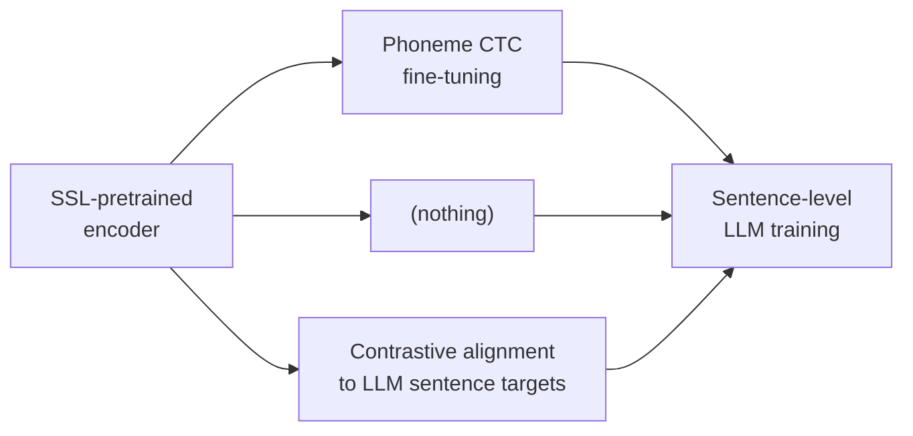
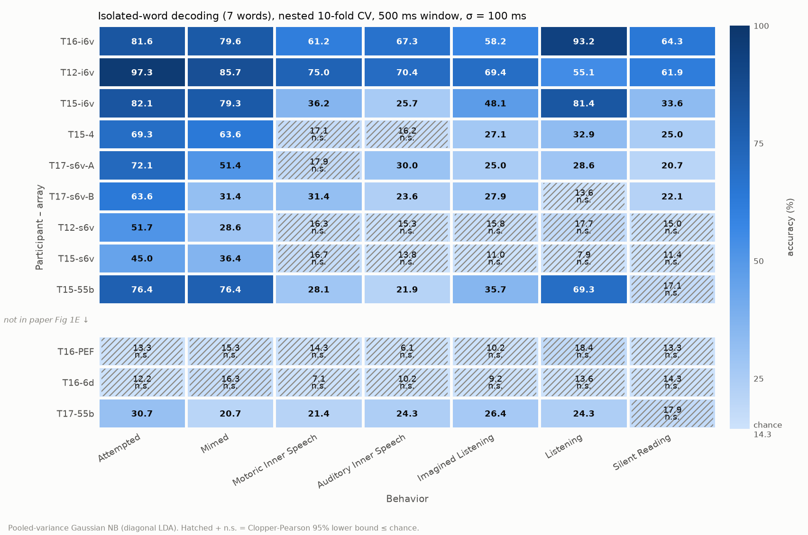

# BIT-Experiments

Experiments on **BIT** (BraIn-to-Text), a brain-to-text decoder that reads attempted speech from
intracortical neural recordings. BIT uses a transformer encoder to turn neural activity into a
sequence of tokens, then feeds those tokens to a language model (Aero-1-Audio, an audio-tuned
Qwen2.5-1.5B, fine-tuned with LoRA) that produces the decoded sentence.

> Zhang et al., "A cross-species neural foundation model for end-to-end speech decoding", ICLR 2026 — [arXiv 2511.21740](https://arxiv.org/abs/2511.21740), code: [yzhang511/bit](https://github.com/yzhang511/bit)

**Main question.** BIT trains its encoder on phoneme labels before connecting it to the language
model, and reports that skipping that stage fails. Can the phoneme stage be replaced by
self-supervised pretraining and contrastive alignment to the language model's own representations?

## Three arms

Every arm starts from the same self-supervised encoder and ends with the same sentence-level
language-model training. They differ only in what happens between those two stages:



| Arm | Middle stage | Status |
|---|---|---|
| **A** — phoneme-first (BIT's recipe) | Phoneme CTC fine-tuning | Phoneme stage done; sentence training queued |
| **B** — direct | None | Sentence training queued, then 2 more seeds |
| **C** — contrastive-first (new) | Contrastive alignment to fixed LLM sentence targets; no LLM, no phonemes | Stage 1 done; sentence training queued |

LLM swaps tested on arm B: Qwen2.5-1.5B-Instruct (trained, under review), Qwen2.5-1.5B base with
no prompt (running), and Fast-dLLM v2 1.5B, a block-diffusion decoder (queued).

No sentence-level (Stage 2) numbers are available yet. Full design: [`docs/DESIGN.md`](docs/DESIGN.md).

## Results so far

Data: Brain-to-Text '25 (participant T15). BIT splits the official validation set into BIT-val
(713 trials) and BIT-test (713 trials). Details and caveats: [`results/SUMMARY.md`](results/SUMMARY.md).
All metrics: [`results/metrics.csv`](results/metrics.csv).

### BIT reproduction

Phoneme error rate 8.91% on BIT-val (paper: 8.87%).

Two properties of BIT's released code affect what its sentence-level numbers mean. First, the
sentence stage never loads the phoneme encoder — the checkpoint key is written to the wrong config
path — so the released end-to-end model is a randomly initialized encoder trained directly on
sentences. Second, the default evaluation is teacher-forced: each word is predicted from the true
preceding words, not generated freely. Every arm in this repo loads its starting checkpoint
explicitly and is scored by free generation. See [`results/SUMMARY.md`](results/SUMMARY.md) for the
full audit.

### SSL pretraining

BIT's masked-modeling objective, trained on 60 hours of speech recordings (three participants).
After correcting for a smoothing leak in BIT's input path, the encoder predicts masked-out neural
activity in held-out recordings at R² = 0.042 (T15) and 0.033 (T12). No-learning baselines
score ≤ 0.


### Contrastive alignment (arm C, Stage 1)

Without any language model or phoneme labels, the encoder retrieves the correct sentence among
704 candidates 35.8% of the time on BIT-test (top-5: 65.2%; chance: 0.14%). It works equally
well on sentences never seen during training (36.1%).

## Kunz et al. 2025 — isolated-word decoding

A self-contained side project reproducing and extending the isolated-word analysis from Kunz et al.
2025, "Inner speech in motor cortex and implications for speech neuroprostheses" (*Cell*,
[PMC12360486](https://pmc.ncbi.nlm.nih.gov/articles/PMC12360486/)), using the public
[Dryad dataset](https://doi.org/10.5061/dryad.gf1vhhn1j). Code and full results: [`kunz/README.md`](kunz/README.md).

**Headline findings:**

1. **Fig 1E reproduces.** Seven-word classification across 12 arrays and 7 behaviors. The paper's
   three benchmark values (T16-i6v listening 92.1%, T12-i6v motoric inner speech 72.6%, T12-i6v
   attempted 97.9%) all fall inside our 95% confidence intervals (ours: 93.2%, 75.0%, 97.3%).
2. **Perception → inner speech transfers.** A decoder trained only on listening decodes inner speech
   well above chance on several arrays. On the i6v arrays this survives strict normalization and
   holds in interleaved sessions where drift cannot explain it.
3. **A 1D-CNN on the binned time series beats the paper's baseline by +5.5 percentage points**
   (mean accuracy 42.2% vs 36.7%, 84 conditions), significantly better in 15 conditions and
   worse in none. The CNN sees the whole trial while the baseline sees one 500 ms window, so
   part of the gain may be coverage rather than temporal dynamics.




## Layout

```
src/bit_experiments/       main package: SSL, contrastive alignment, sentence training, evaluation
scripts/                   one entry point per step
configs/                   all settings; BIT's configs patched only by scripts/patch_bit_configs.py
docs/                      design, SSL plan, pretraining-data inventory
results/, figures/         outputs
external/bit               BIT, pinned submodule (f107ae9)
kunz/                      Kunz et al. 2025 side project (see kunz/README.md)
```

<details>
<summary><strong>Setup and pipeline</strong></summary>

### Setup

```bash
git clone --recurse-submodules git@github.com:molinzhao27/BIT-Experiments.git
pip install -e ".[dev,eval]"
python -m pytest                  # CPU, seconds
```

Training uses BIT's environment: Python 3.10, `configs/bit_requirements.txt`, and the torch build
in `configs/bit_baseline.yaml` (2.7.1 + CUDA 12.8). Then:

```bash
python scripts/patch_bit_configs.py      # apply configs/bit_baseline.yaml to BIT's trainer YAMLs
python scripts/fetch_llms.py             # pinned LLM snapshots -> checkpoints/hf/
```

Data goes in `data/raw/` (gitignored): Brain-to-Text '25 (`brandman_2024_text`), Brain-to-Text '24
(`willett_2023_text`), and the Kunz sentence sessions (`kunz/scripts/fetch_data.py`). Sources and
checksums: [`docs/PRETRAIN_DATA.md`](docs/PRETRAIN_DATA.md).

### Pipeline

```bash
# 1. SSL pretraining
python scripts/build_ssl_corpus.py
python scripts/pretrain_ssl.py
python scripts/export_finetune_core.py

# 2. BIT reproduction; arm A phoneme stage
python scripts/run_bit_baseline.py
python scripts/run_bit_baseline.py --stages phoneme eval_phoneme \
    --phoneme-init checkpoints/ssl_human/BEST_core_ft --tag armA_ssl --out results/armA_ssl_phoneme

# 3. Arm C, Stage 1: contrastive alignment
python scripts/cache_text_targets.py
python scripts/train_stage1.py --out checkpoints/stage1/C_l14_b1024_s42

# 4. Stage 2 (every arm), with free-generation evaluation
python scripts/train_stage2.py --name A_ssl_s42 --arm A --init <phoneme BEST>
python scripts/train_stage2.py --name B_ssl_s42 --arm B --init checkpoints/ssl_human/BEST_core
python scripts/train_stage2.py --name C_ssl_s42 --arm C --init checkpoints/stage1/C_l14_b1024_s42
python scripts/train_stage2.py --name B_ssl_qwen25-1.5b-instruct_s42 --arm B \
    --init checkpoints/ssl_human/BEST_core --llm qwen2.5-1.5b-instruct    # LLM swap

# 5. Score and compare
python scripts/evaluate_decodes.py score <decodes.csv>
python scripts/evaluate_decodes.py summarize
```

Every run is seeded (default 42); configurations are compared over 3 seeds.

</details>
